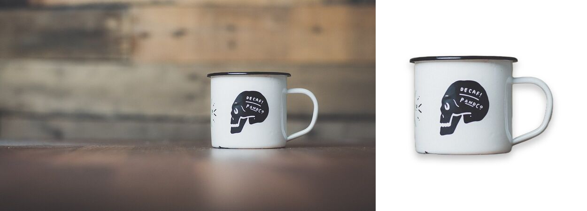
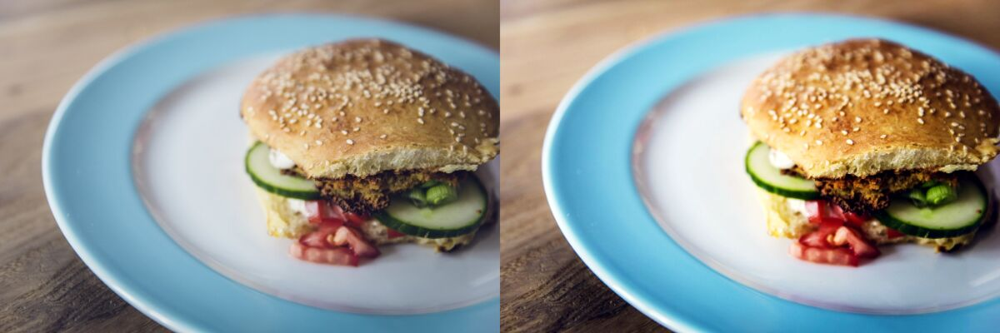
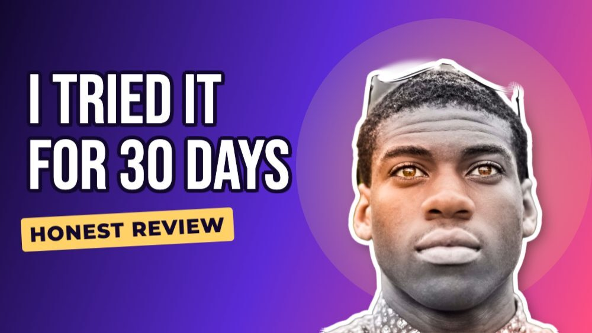
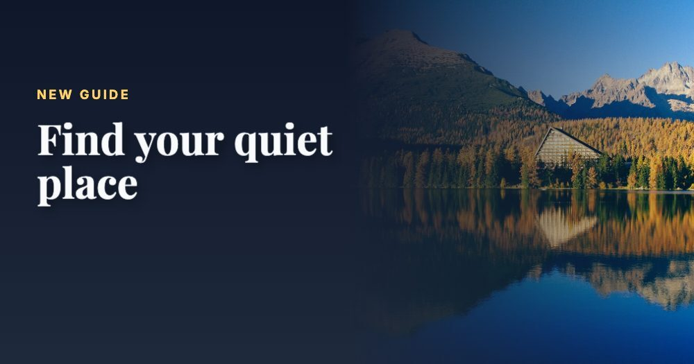
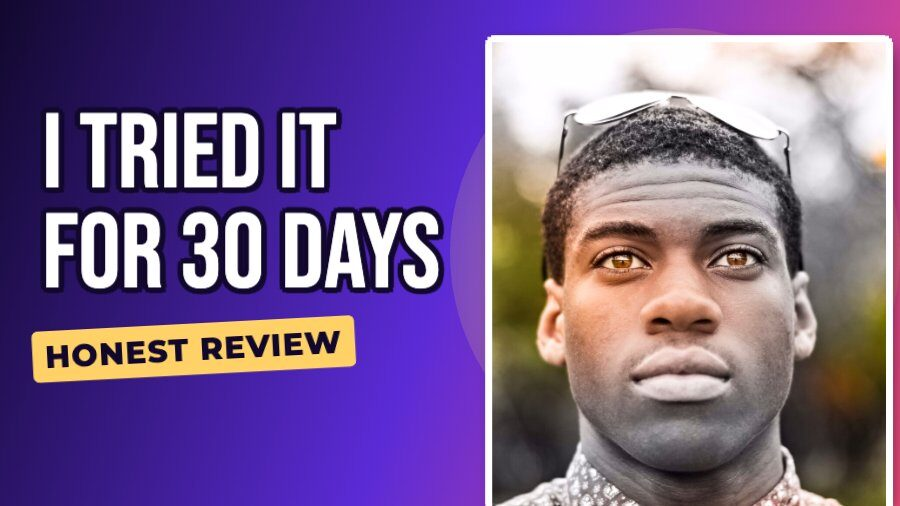
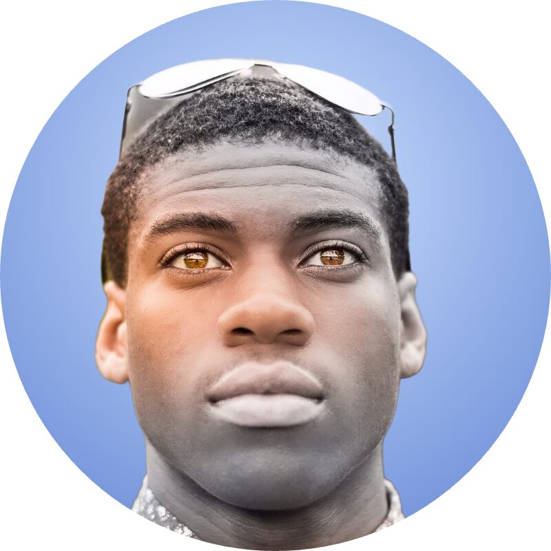

<h1 align="center">AgentPhoto</h1>

<p align="center">
  <strong>The photo studio your AI agent can run.</strong><br>
  Retouching, background removal, masks, looks, text and social formats, as a non-destructive document.<br>
  Everything runs on your computer: no server, no account, no upload.
</p>

<p align="center">
  <a href="https://www.npmjs.com/package/@fleox/agentphoto"></a>
  <a href="https://www.npmjs.com/package/@fleox/agentphoto"></a>
  <a href="#claude-code"></a>
  <a href="#mcp-server"></a>
  <a href="https://github.com/fleox/agentphoto/blob/main/LICENSE"></a>
</p>

<p align="center">
  <a href="#quick-start">Quick start</a> ·
  <a href="#what-you-can-ask">What you can ask</a> ·
  <a href="#examples">Examples</a> ·
  <a href="#how-it-works">How it works</a> ·
  <a href="#the-studio">Studio</a> ·
  <a href="#privacy">Privacy</a> ·
  <a href="https://github.com/fleox/agentphoto/blob/main/docs/README.md">Docs</a>
</p>

<p align="center">
  
  <br><sub>One sentence to the agent: <i>"cut the mug out, put it on white with a soft shadow, square, for my shop"</i>. Real output, no retouching by hand.</sub>
</p>

---

## Why AgentPhoto

<table>
<tr>
<td width="33%" valign="top">
<h3>🤖 Agent-native</h3>
<p>A picture is one JSON document: a stack of layers with filters, masks and effects, validated with "did you mean" hints and edited with small atomic patches. The agent <b>renders it headless</b> in your own Chrome, <b>looks at the image</b>, fixes what it sees and runs <code>check</code> before exporting.</p>
</td>
<td width="33%" valign="top">
<h3>🎛️ A real photo editor</h3>
<p>28 filters (levels, curves, white balance, shadows / highlights, clarity, surface blur…), 20 looks, adjustment layers, blend modes, masks, layer effects, text in 15 bundled fonts, shapes, gradients, 8 templates and 13 size presets. Non-destructive: your original is never touched.</p>
</td>
<td width="33%" valign="top">
<h3>🔒 Private by design</h3>
<p>Background removal and Segment Anything masks run <b>locally</b> (RMBG-1.4, MODNet, SlimSAM). Models download once, then everything works offline. No server, no account, no telemetry, and your photos never leave your computer.</p>
</td>
</tr>
</table>

## Quick start

### With an AI agent

<a id="claude-code"></a>**Claude Code**

```text
/plugin marketplace add fleox/agentphoto
/plugin install agentphoto@agentphoto
```

Then ask in your own words (see [what you can ask](#what-you-can-ask)). The agent opens your photo as a project, edits it, renders it, looks at the result, fixes it, and exports the files.

| Agent | Setup |
|---|---|
| **Claude Code** | the plugin above: skills `agentphoto-retouch`, `agentphoto-cutout`, `agentphoto-design`, `agentphoto-publish` |
| **Claude Desktop, Cursor, any MCP client** | the [MCP server](#mcp-server): `agentphoto mcp --project <dir>` |
| **Codex, Windsurf, any other agent** | point it at [AGENTS.md](https://github.com/fleox/agentphoto/blob/main/AGENTS.md) and the Markdown skills in [plugin/skills/](https://github.com/fleox/agentphoto/tree/main/plugin/skills) |

You need **Node.js 22+** and **Google Chrome** (or Chromium / Edge / Brave): previews, exports and the AI run in it, headless. `npx -y @fleox/agentphoto@0.1.0 doctor` checks your setup.

### Without an agent

```bash
npx -y @fleox/agentphoto@0.1.0 new trip --image ./lake.jpg
npx -y @fleox/agentphoto@0.1.0 studio --project trip
```

The first command makes a project folder from your photo; the second opens the [Studio](#the-studio) on it. Or the whole loop from a terminal:

```bash
npx -y @fleox/agentphoto@0.1.0 analyze --project trip                    # brightness, range, colour cast… + suggested filters
npx -y @fleox/agentphoto@0.1.0 filter add photo --type shadowsHighlights --set shadows=30 --project trip
npx -y @fleox/agentphoto@0.1.0 remove-bg photo --background "#ffffff" --project trip
npx -y @fleox/agentphoto@0.1.0 render --project trip --compare           # → renders/preview-before.png + preview.png
npx -y @fleox/agentphoto@0.1.0 export --project trip --format webp --quality 82
```

Step by step: [docs/getting-started.md](https://github.com/fleox/agentphoto/blob/main/docs/getting-started.md).

## What you can ask

> *Here's `~/Desktop/mug.jpg`: remove the background, put it on white with a soft shadow, square, 2000 px for my shop.*<br>
> *This photo is too dark and a bit orange. Fix the colours, keep it natural.*<br>
> *Retouch my portrait for LinkedIn: smooth the skin a little, open the shadows, not too much. Then make a round avatar.*<br>
> *Make a YouTube thumbnail from `me.jpg`: "I tried it for 30 days", cut me out with a white outline, bold colours.*<br>
> *Turn this landscape into an Instagram post with the caption "Slow mornings at the lake", a story version too.*<br>
> *Give it a film look, then a black and white version with grain. Show me both.*<br>
> *Blur the background behind my cat.*<br>
> *Export it as WebP under 150 KB for my blog, and an Open Graph image.*

## Examples

Real before / after renders from the commands in [docs/retouching.md](https://github.com/fleox/agentphoto/blob/main/docs/retouching.md), on the built-in CC0 sample photos.

<table>
<tr>
<td width="50%" valign="top"><p align="center"><b>Colour correction</b>: levels, a gentle S-curve, white balance, vibrance, sharpening</p></td>
<td width="50%" valign="top"><p align="center"><b>Portrait retouch</b>: skin selected with Segment Anything points, surface blur on a masked copy, shadows / highlights</p></td>
</tr>
<tr>
<td width="50%" valign="top"><p align="center"><b>YouTube thumbnail</b>: the <code>youtube-thumbnail</code> template + your photo + <code>remove-bg</code></p></td>
<td width="50%" valign="top"><p align="center"><b>Link preview (1200×630)</b>: a gradient mask fades the photo into the text panel</p></td>
</tr>
</table>

### Templates

| | | | |
|---|---|---|---|
| <br>`youtube-thumbnail` 1280×720 | <br>`og-article` 1200×630 | <br>`social-quote` 1080×1080 | <br>`story-promo` 1080×1920 |
| <br>`sale-banner` 1920×600 | <br>`polaroid` 1080×1350 | <br>`avatar-pro` 800×800 | <br>`product-white` 2000×2000 |

`agentphoto new my-post --template <id> --image ./photo.jpg` puts your photo into the template's slot, with its framing, filters and effects.

## How it works

```text
  You / your agent ──► Studio · agentphoto CLI · MCP server · Studio assistant
                                    │   (one AI tool catalog)
                                    ▼
          src/ops — validate, patch, crop / resize, check, plan exports (pure TypeScript)
                                    │
             project folder: photo.json · assets/ (images, masks) · renders/ · dist/
                                    │
          src/engine — compositor, filters, looks, text, effects, local AI
                       in your own Chrome (headless) or the Studio page
```

All the rules live in one engine. The Studio, the CLI, the MCP server and the Studio assistant are four front doors to it, so an agent can do exactly what you can do in the editor, with the same validation.

A picture is **data**: `photo.json` lists layers bottom to top (image, text, shape, fill, adjustment, group), each with its box, opacity, blend mode, mask, filters and effects. The render is a pure function of (document, files, fonts). That is what makes the loop work: the agent patches the JSON, `render` composites it in headless Chrome and writes a PNG, the agent **looks** at it, fixes, runs `check` (missing files, layers off the canvas, upscaled photos, text overflow, licences) and exports PNG / JPEG / WebP at any size. Nothing is ever baked: every filter, mask and cut-out can be changed or removed later. Details: [architecture](https://github.com/fleox/agentphoto/blob/main/docs/architecture.md) and the [document format](https://github.com/fleox/agentphoto/blob/main/docs/document-format.md).

```json
{ "id": "correct", "type": "adjustment", "filters": [
  { "type": "levels", "black": 20, "white": 235 },
  { "type": "temperature", "temperature": -8 },
  { "type": "look", "look": "film", "amount": 0.6 }
] }
```

## The Studio

A visual editor for when you want to see and touch the picture yourself, on the same files and with the same validated tools as the agent. Changes your agent makes in a terminal appear live in the open Studio.

```bash
npx -y @fleox/agentphoto@0.1.0 studio --project trip
```

Canvas with move, crop, text, shape and eyedropper tools, layers panel, inspector (properties, filters with a curve editor, looks, layer effects, masks), AI cut-out and masks in the page, export dialog, templates gallery, undo / redo, in English or French. An optional assistant panel calls the Claude API from your browser with your own key, over the same tools. See [docs/studio.md](https://github.com/fleox/agentphoto/blob/main/docs/studio.md).

## The `agentphoto` CLI

The same engine the agents use, by hand: `npx -y @fleox/agentphoto@0.1.0 help`. Every command accepts `--json` and prints exactly one `{ ok, data }` or `{ ok: false, error }` object with an actionable hint; commands that remove or overwrite something print a plan until you add `--yes`.

| Area | Commands |
|---|---|
| Project | `new <dir> [--image] [--template] [--size]`, `info`, `templates list\|show`, `doctor`, `version`, `help` |
| Edit | `doc get\|summary\|apply\|patch\|validate`, `layer list\|get\|add\|update\|remove\|move`, `filter add\|update\|remove`, `mask set\|clear\|generate`, `remove-bg`, `catalog [section] [id]` |
| Look at it | `analyze`, `render [--compare] [--layer] [--zoom]`, `check`, `studio` |
| Ship | `export [--format] [--quality] [--preset] [--width\|--height\|--scale] [--fit] [--variants]` |
| Files and models | `assets list\|add\|remove\|library`, `models list\|pull\|remove` |
| AI | `tools list\|call`, `mcp [--read-only]` |

Full reference: [docs/cli.md](https://github.com/fleox/agentphoto/blob/main/docs/cli.md).

## MCP server

```bash
claude mcp add agentphoto -- npx -y @fleox/agentphoto@0.1.0 mcp --project ~/Pictures/my-photo
```

**Tools** are the shared AI catalog: project info and creation, document summary / get / patch / apply / validate, layers, filters, masks, `remove_background`, `mask_generate`, `image_analyze`, catalog and templates lookups, assets, `check` and `export`, plus **`render_preview`**, which returns the render as an **image** so multimodal models see their work. **Resources**: `photo://doc`, `photo://summary`, `photo://catalog`. Claude Desktop and Cursor configuration: [docs/mcp.md](https://github.com/fleox/agentphoto/blob/main/docs/mcp.md).

## Privacy

- **Local.** Projects are folders on your disk; editing, previews, analysis, AI and exports run on your computer, in Node.js and your own browser engine.
- **No upload.** Your photos are never sent anywhere. The AI models come to the photos: they download **once** from Hugging Face into `~/.cache/agentphoto/models` and then run offline.
- **Nothing else phones home.** No account, no telemetry, no update check, no CDN, no web fonts. The only other network uses are importing an image from a URL you give, and the optional Studio assistant (your own Claude API key, to `api.anthropic.com`).
- **Non-destructive.** Source files are copied, never modified; AI masks are new files.

Details: [docs/security.md](https://github.com/fleox/agentphoto/blob/main/docs/security.md).

## Documentation

| | |
|---|---|
| [Getting started](https://github.com/fleox/agentphoto/blob/main/docs/getting-started.md) | Install, a first edit in six commands, using it from an agent |
| [Retouching recipes](https://github.com/fleox/agentphoto/blob/main/docs/retouching.md) | Colour correction, portrait retouch, product cut-out on white, social formats |
| [Document format](https://github.com/fleox/agentphoto/blob/main/docs/document-format.md) · [Catalog](https://github.com/fleox/agentphoto/blob/main/docs/catalog.md) | `photo.json` field by field; every filter, look, effect, font and size preset |
| [Studio](https://github.com/fleox/agentphoto/blob/main/docs/studio.md) · [Studio API](https://github.com/fleox/agentphoto/blob/main/docs/studio-api.md) | The visual editor; its local REST API |
| [CLI](https://github.com/fleox/agentphoto/blob/main/docs/cli.md) · [MCP](https://github.com/fleox/agentphoto/blob/main/docs/mcp.md) | Every command; MCP clients |
| [Architecture](https://github.com/fleox/agentphoto/blob/main/docs/architecture.md) · [Security and privacy](https://github.com/fleox/agentphoto/blob/main/docs/security.md) | The engine and the render loop; what touches the network |
| [AGENTS.md](https://github.com/fleox/agentphoto/blob/main/AGENTS.md) | Instructions for AI agents working on this repository |

## Contributing

Bug reports and ideas are welcome: [open an issue](https://github.com/fleox/agentphoto/issues).

```bash
npm install
npm run dev        # the Studio (projects in the browser)
npm test           # Vitest
npm run build      # engine + Studio + CLI
```

## License

Source-available under the [PolyForm Noncommercial License 1.0.0](https://github.com/fleox/agentphoto/blob/main/LICENSE). Personal, hobbyist, educational, research and other noncommercial use is free, and you can fork, modify and redistribute under the same terms.

**Commercial use requires written authorization.** This includes selling the software or hosting it as a paid service. For a commercial license, [open an issue](https://github.com/fleox/agentphoto/issues).

**AI models** are downloaded from Hugging Face under their own licences: **RMBG-1.4** (BRIA AI, the default background remover) is **non-commercial only** (`bria-rmbg-1.4` licence; commercial use needs a licence from BRIA); **MODNet**, **SlimSAM** and **SAM** are **Apache-2.0**. `agentphoto models list` shows each one.

**Bundled content**: fonts under the SIL Open Font License 1.1 (Roboto Slab: Apache-2.0) and sample photos under CC0 1.0; see [library/LICENSES.md](https://github.com/fleox/agentphoto/blob/main/library/LICENSES.md). AgentPhoto runs the models with [transformers.js](https://github.com/huggingface/transformers.js) and [ONNX Runtime Web](https://onnxruntime.ai) (Apache-2.0 / MIT).
