<p align="center">
  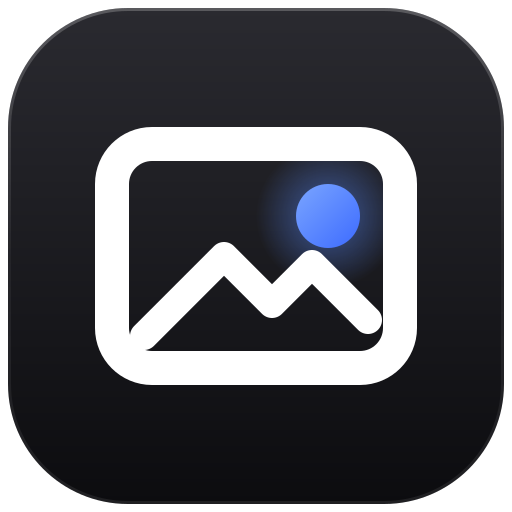
</p>

<h1 align="center">AgentPhoto</h1>

<p align="center">
  <strong>The photo studio your AI agent can run.</strong><br>
  Retouching, background removal, masks, looks, text and social formats, as a non-destructive document.<br>
  Everything runs on your computer: no server, no account, nothing that phones home.
</p>

<p align="center">
  <a href="https://www.npmjs.com/package/@fleox/agentphoto"></a>
  <a href="https://github.com/fleox/agentphoto/actions/workflows/ci.yml"></a>
  <a href="https://www.npmjs.com/package/@fleox/agentphoto"></a>
  <a href="#claude-code"></a>
  <a href="#mcp-server"></a>
  <a href="https://github.com/fleox/agentphoto/blob/main/LICENSE"></a>
</p>

<p align="center">
  <a href="#quick-start">Quick start</a> ·
  <a href="#features">Features</a> ·
  <a href="#the-studio">Studio</a> ·
  <a href="#templates">Templates</a> ·
  <a href="#how-it-works">How it works</a> ·
  <a href="#the-agentphoto-cli">CLI</a> ·
  <a href="#mcp-server">MCP</a> ·
  <a href="#privacy">Privacy</a> ·
  <a href="https://github.com/fleox/agentphoto/blob/main/docs/README.md">Docs</a> ·
  <a href="https://github.com/fleox/agentphoto/blob/main/changelog.json">Changelog</a>
</p>

<p align="center">
  <a href="https://cdn.jsdelivr.net/gh/fleox/agentphoto@main/.github/assets/agentphoto-demo.mp4">
    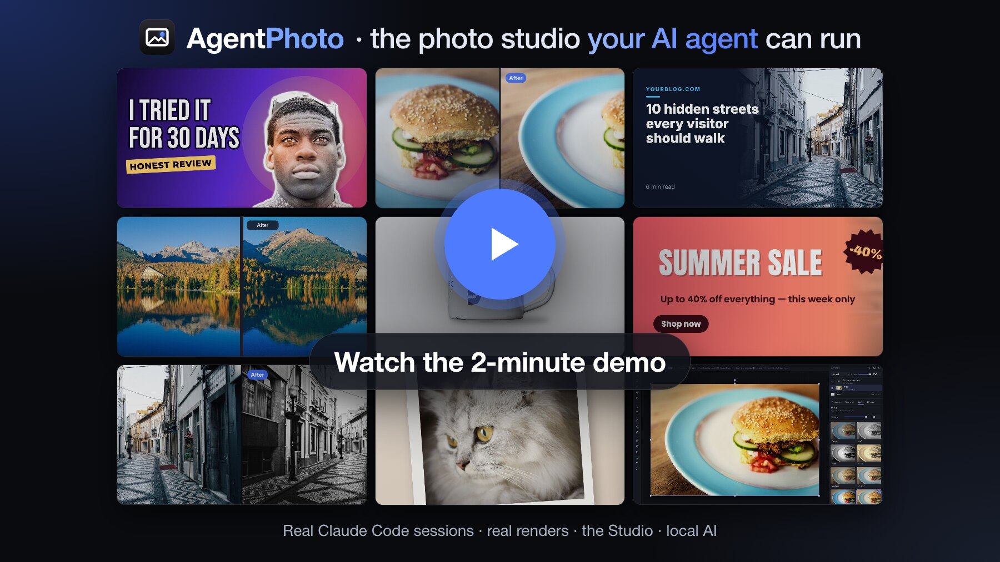
  </a>
  <br><sub>▶️ <a href="https://cdn.jsdelivr.net/gh/fleox/agentphoto@main/.github/assets/agentphoto-demo.mp4">Watch the demo</a> (2 min 10 s): three real Claude Code sessions (a photo retouch, a product cut-out on white, a YouTube thumbnail; the agent's work sped up, labelled on screen), then templates, the Studio and the export.</sub>
</p>

---

## Why AgentPhoto

<table>
<tr>
<td width="33%" valign="top">
<h3>🎛️ A real photo editor</h3>
<p>28 filters (levels, curves, white balance, shadows / highlights, clarity, surface blur…), 20 looks, adjustment layers, 16 blend modes, masks, layer effects, text in 15 bundled fonts, shapes and gradients. <b>Non-destructive</b>: every edit is a layer you can change later, and your original is never touched.</p>
</td>
<td width="33%" valign="top">
<h3>🤖 Agent-native</h3>
<p>A picture is one JSON document, validated with "did you mean" hints and edited with small atomic patches. The agent <b>renders it headless</b> in your own Chrome, <b>looks at the image</b>, fixes what it sees and runs <code>check</code> before exporting. Every action is a CLI command with JSON output, an MCP tool and a Studio action.</p>
</td>
<td width="33%" valign="top">
<h3>🔒 Local AI, no server</h3>
<p>Background removal and Segment Anything masks run <b>on your computer</b> (RMBG-1.4, MODNet, SlimSAM). Models download once, then everything works offline. No AgentPhoto server, account or telemetry; AgentPhoto itself uploads nothing.</p>
</td>
</tr>
</table>

## Quick start

### With an AI agent

<a id="claude-code"></a>**Claude Code**

```text
/plugin marketplace add fleox/agentphoto
/plugin install agentphoto@agentphoto
```

Then just ask:

> *Here is a photo from my trip, lake.jpg. Make it look great: fix the light and colours, give it a warm film look, then export it for Instagram (square) and as a link preview image.*<br>
> *Remove the background of mug.jpg and make a clean product photo for my shop: on white, square, with a soft shadow under the mug. Export it as a 2000 px JPEG.*<br>
> *Make a YouTube thumbnail for my video "Lisbon on foot" with street.jpg: big bold title, readable on a phone. Then make the matching link preview image for the blog post.*

The agent opens your photo as a project, measures it, edits it with layers and filters, renders it, **looks at the result**, fixes it, runs `check` and exports the files.

<p align="center">
  
  <br><sub>A real, unedited Claude Code session. The agent's work (about 2 minutes) is sped up ×8 (labelled); typing and the answer play in real time. It ends on the agent's own before / after render.</sub>
</p>

Cut-outs run locally, and the agent picks the model that fits the use:

<p align="center">
  
  <br><sub>For a shop (commercial use) the agent chose Segment Anything (Apache-2.0) over the default non-commercial background remover, then centred the mug on white with a contact shadow. Sped up ×8 while the agent works (labelled).</sub>
</p>

<details>
<summary><b>And a third one: <i>"Make a YouTube thumbnail for my video…"</i></b></summary>
<p align="center">
  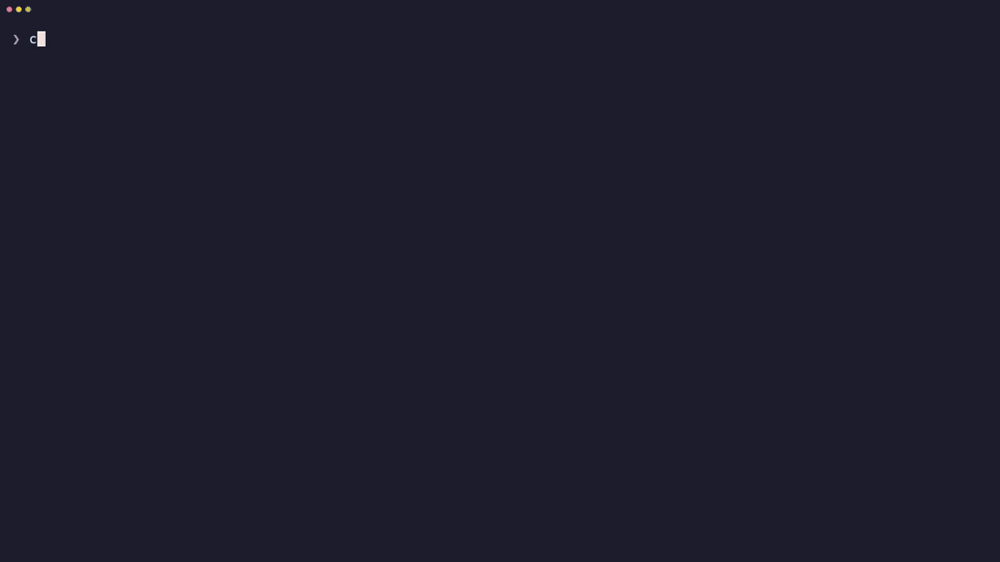
  <br><sub>A thumbnail from a template, checked at the size it shows on a phone, then the matching link preview. Sped up ×16 while the agent works (labelled).</sub>
</p>
</details>

| Agent | Setup |
|---|---|
| **Claude Code** | the plugin above: skills `agentphoto-retouch`, `agentphoto-cutout`, `agentphoto-design`, `agentphoto-publish` |
| **Claude Desktop, Cursor, any MCP client** | the [MCP server](#mcp-server): `agentphoto mcp --project <dir>` |
| **Hermes Agent** / Python agents | generated skills with a Python wrapper and helpers, see [hermes/](https://github.com/fleox/agentphoto/tree/main/hermes) |
| **Codex, Windsurf, any other agent** | point it at [AGENTS.md](https://github.com/fleox/agentphoto/blob/main/AGENTS.md) and the Markdown skills in [plugin/skills/](https://github.com/fleox/agentphoto/tree/main/plugin/skills) |

You need **Node.js 22+** and **Google Chrome** (or Chromium / Edge / Brave): previews, exports and the AI run in it, headless. `npx -y @fleox/agentphoto@0.1.0 doctor` checks your setup with a test render.

### Without an agent

```bash
npx -y @fleox/agentphoto@0.1.0 new trip --image ./lake.jpg
npx -y @fleox/agentphoto@0.1.0 studio --project trip
```

The first command makes a project folder from your photo (add `--template <id>` to start from one of the [templates](#templates)); the second opens the [Studio](#the-studio) on it. The whole loop from a terminal:

```bash
npx -y @fleox/agentphoto@0.1.0 analyze --project trip                    # brightness, range, colour cast… + suggested filters
npx -y @fleox/agentphoto@0.1.0 filter add photo --type shadowsHighlights --set shadows=30 --project trip
npx -y @fleox/agentphoto@0.1.0 remove-bg photo --background "#ffffff" --project trip
npx -y @fleox/agentphoto@0.1.0 render --project trip --compare           # → renders/preview-before.png + preview.png
npx -y @fleox/agentphoto@0.1.0 export --project trip --format webp --quality 82
```

Step by step: [docs/getting-started.md](https://github.com/fleox/agentphoto/blob/main/docs/getting-started.md).

## Features

<table>
<tr>
<td width="50%">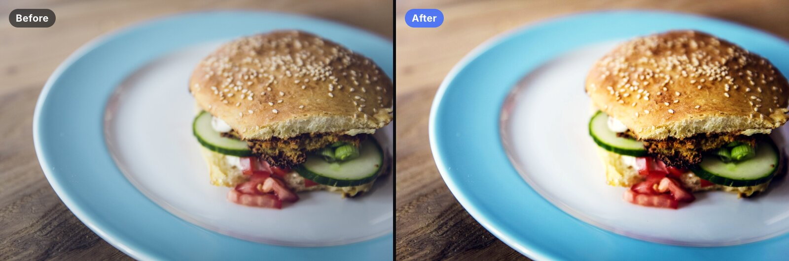<p align="center"><b>Colour correction</b>: levels, a gentle S-curve, warmth, vibrance, sharpening</p></td>
<td width="50%">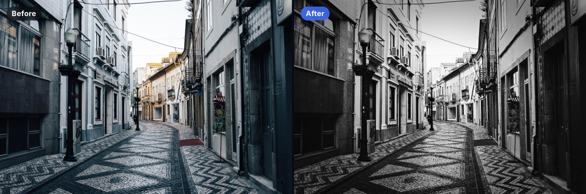<p align="center"><b>Black and white</b>: channel mix, curve, clarity, grain, vignette</p></td>
</tr>
<tr>
<td width="50%">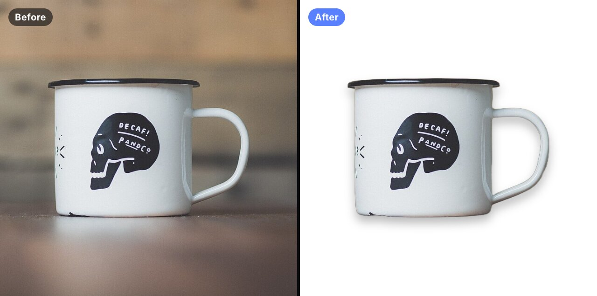<p align="center"><b>Product cut-out</b>: local AI background removal, white backdrop, contact shadow</p></td>
<td width="50%">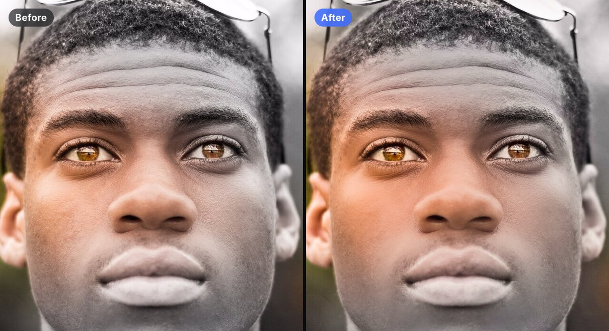<p align="center"><b>Portrait retouch</b>: skin selected with Segment Anything, edge-preserving smoothing, open shadows</p></td>
</tr>
<tr>
<td width="50%">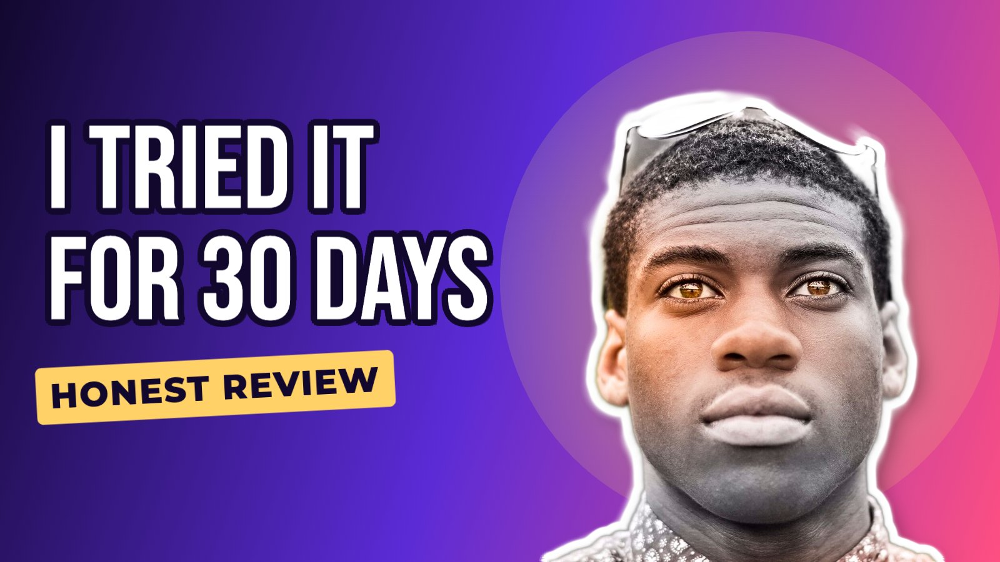<p align="center"><b>YouTube thumbnail</b>: template + your photo + <code>remove-bg</code> + a stroke effect</p></td>
<td width="50%">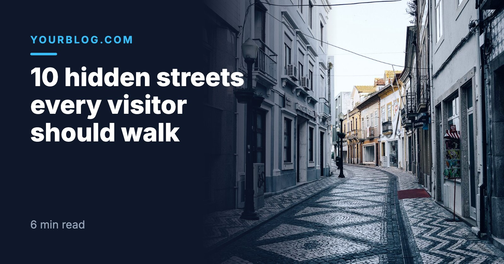<p align="center"><b>Link preview (1200×630)</b>: a gradient mask fades the photo into the text panel</p></td>
</tr>
</table>

<p align="center">
  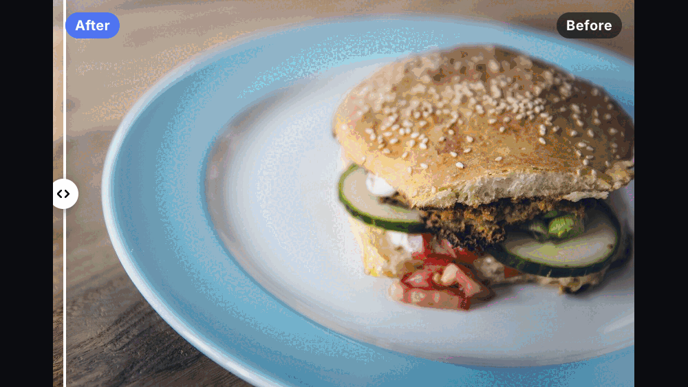
  <br><sub>Real renders from the published package, nothing painted over.</sub>
</p>

- **Retouch**: `analyze` measures brightness, range, clipping, saturation and colour cast and suggests filters; light (exposure, brightness / contrast, shadows / highlights), tone (levels, curves), colour (white balance, hue / saturation, vibrance, colour balance, photo filter, gradient map), detail (sharpen, clarity), blur (gaussian, motion, edge-preserving surface blur), stylize (vignette, noise, posterize, threshold, pixelate) and one-click auto tone / contrast / colour.
- **Looks**: 20 graded looks (film, cinema, golden hour, noir, matte, cross-process…) with an amount, on a layer or on everything below an adjustment layer.
- **Cut-outs and masks**: background removal (RMBG-1.4, MODNet), Segment Anything from points or a box (SlimSAM, SAM), colour-range masks, shape and gradient masks with feather, density and invert, clipping masks, masks painted by hand in the Studio.
- **Design**: text in 15 bundled fonts with real measurement and wrapping, shapes (rect, ellipse, line, polygon, star), linear and radial gradients, 5 layer effects (drop shadow, outer glow, inner shadow, stroke, colour overlay), 16 blend modes, groups, 8 templates and 13 size presets.
- **Geometry**: crop, straighten, resize the canvas or the whole picture, rotate and flip, without rasterising anything.
- **Quality**: `check` before export (missing files, layers off the canvas, upscaled photos, text that may overflow, licences to credit); exports plan before overwriting and warn when a size upscales or a crop cuts a layer.
- **Export**: PNG, JPEG, WebP (AVIF where the browser can encode it), quality, background, transparency, every size preset or exact width / height / scale, cover or contain, several variants in one command.

## The Studio

A visual editor for when you want to see and touch the picture yourself, on the same files and with the same validated tools as the agent. Changes your agent makes in a terminal appear live in the open Studio.

```bash
npx -y @fleox/agentphoto@0.1.0 studio --project trip
```

<p align="center">
  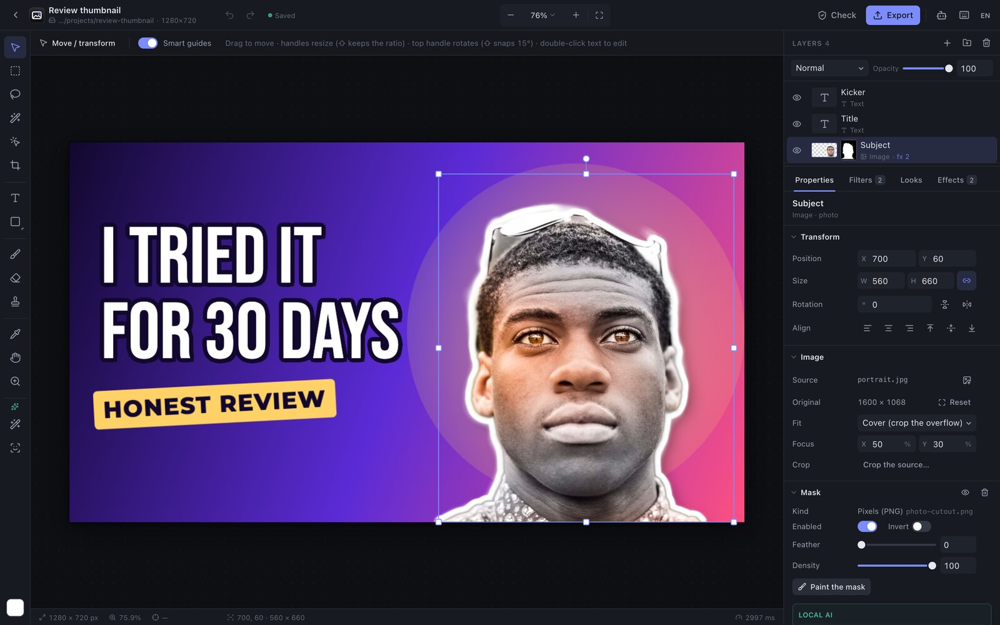
</p>

<table>
<tr>
<td width="50%">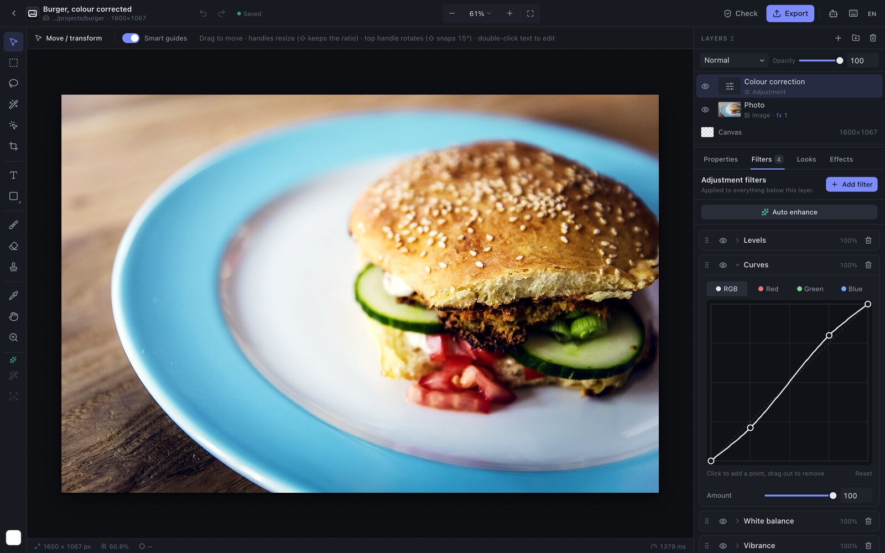<p align="center"><b>Filters</b>: every filter with its sliders, a curve editor, drag to reorder</p></td>
<td width="50%">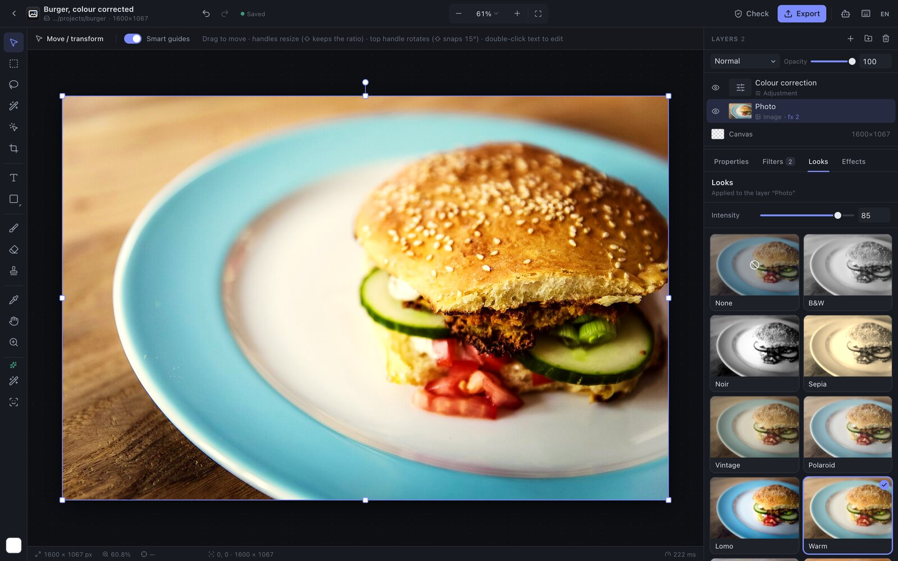<p align="center"><b>Looks</b>: thumbnails rendered from your photo, one click, an intensity slider</p></td>
</tr>
<tr>
<td width="50%">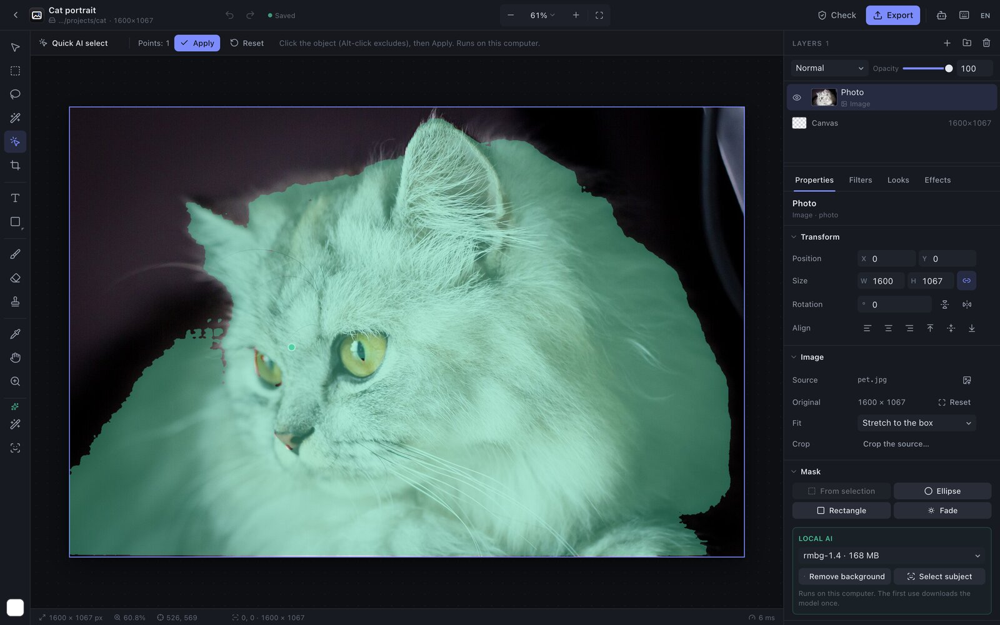<p align="center"><b>Quick AI select</b>: click the subject, Segment Anything selects it, locally</p></td>
<td width="50%">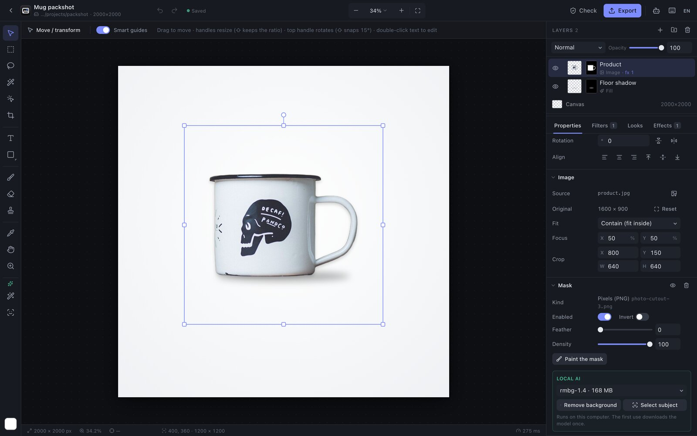<p align="center"><b>Masks</b>: AI cut-outs you can refine, feather, invert or paint by hand</p></td>
</tr>
<tr>
<td width="50%">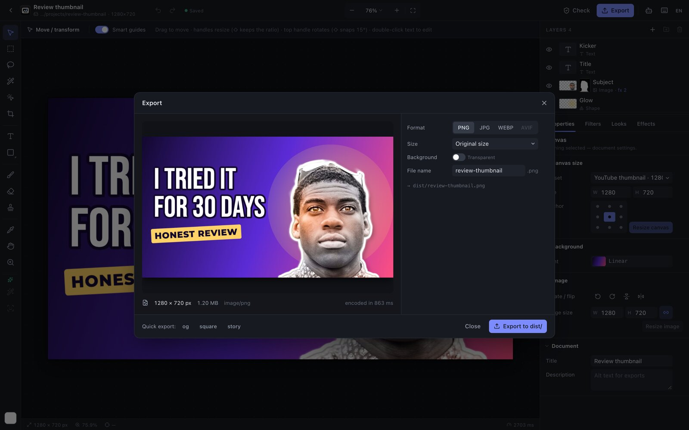<p align="center"><b>Export</b>: live preview with the real file size, quick social sizes</p></td>
<td width="50%">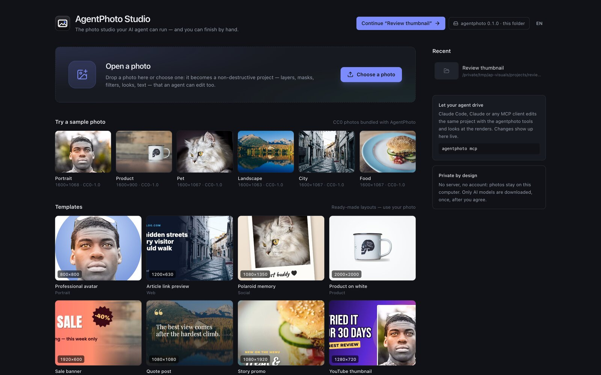<p align="center"><b>Start</b>: open a photo, a sample, a template or a recent project</p></td>
</tr>
</table>

Canvas with move / transform, crop, brush, eraser, clone stamp, marquee, lasso, magic wand, quick AI select, text, shape and eyedropper tools; layers panel; inspector (properties, filters with a curve editor, looks, layer effects, masks); AI cut-out in the page; export dialog; templates gallery; undo / redo; in English or French. An optional assistant panel calls the Claude API from your browser with your own key, over the same tools. Without `agentphoto studio`, the same Studio also works from a static build with projects stored in the browser. See [docs/studio.md](https://github.com/fleox/agentphoto/blob/main/docs/studio.md).

## Templates

<p align="center">
  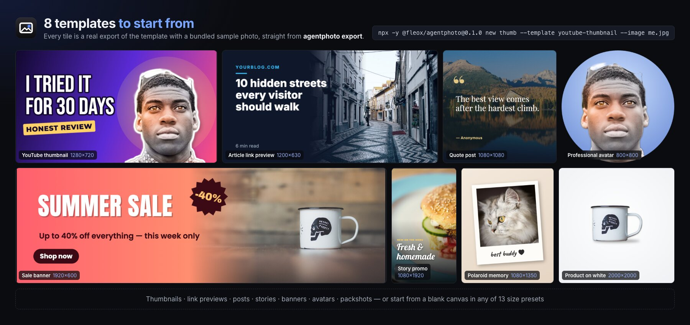
</p>

`agentphoto new my-post --template <id> --image ./photo.jpg` puts your photo into the template's slot, with its framing, filters and effects; `templates list` and `templates show <id>` describe them. Everything stays editable: a template is an ordinary `photo.json`.

<details>
<summary><b>All 8 templates</b></summary>

| | Template | Size | What it is |
|---|---|---|---|
|  | **YouTube thumbnail**<br>`youtube-thumbnail` | 1280×720 | Bold 16:9 thumbnail: big condensed title, subject with a white outline, punchy gradient |
| 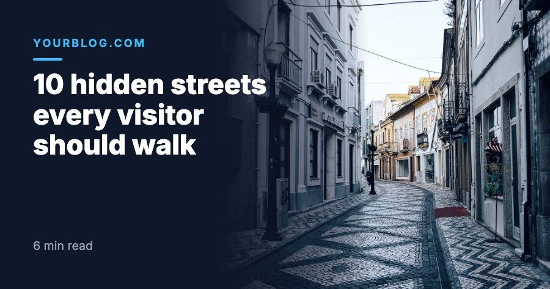 | **Article link preview**<br>`og-article` | 1200×630 | Open Graph card: photo on the right fading into a solid panel, headline and site name on the left |
| 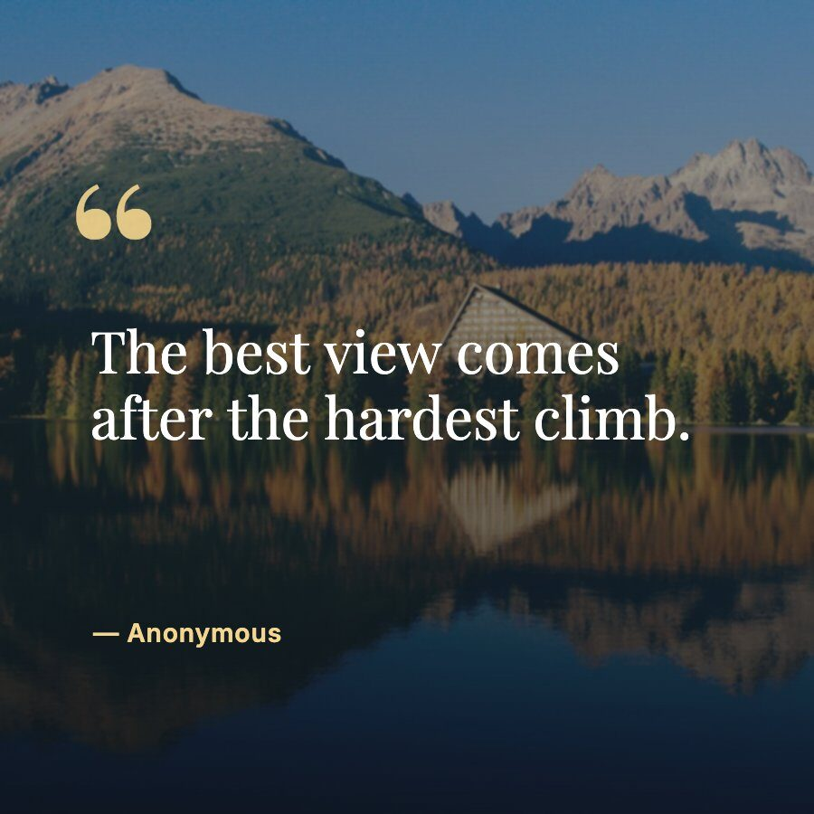 | **Quote post**<br>`social-quote` | 1080×1080 | Square post: photo in the background, darkened and softened, with a serif quote and author |
| 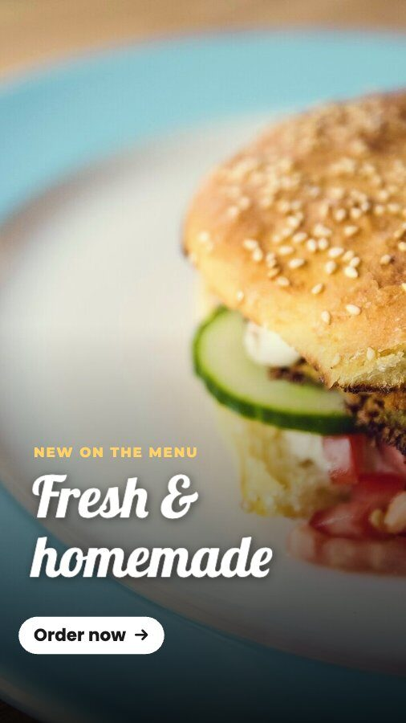 | **Story promo**<br>`story-promo` | 1080×1920 | 9:16 story / reel cover: full-bleed photo, dark gradient, big title and a call-to-action pill |
| 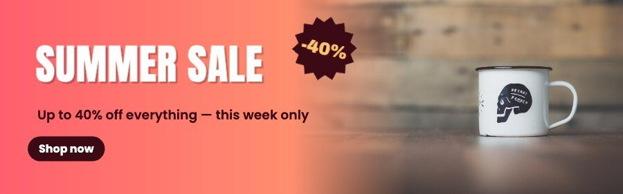 | **Sale banner**<br>`sale-banner` | 1920×600 | Wide web hero banner: gradient background, photo fading in, big discount and a starburst badge |
| 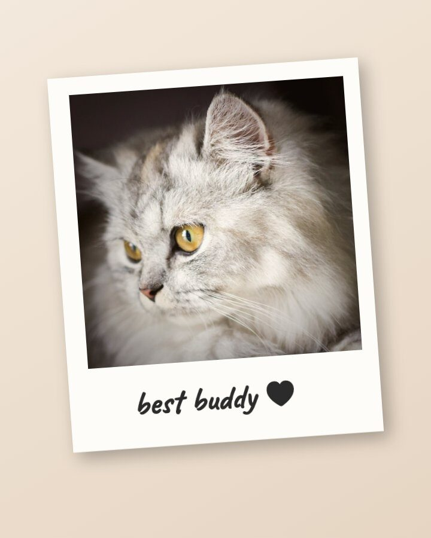 | **Polaroid memory**<br>`polaroid` | 1080×1350 | Instant-photo card tilted on warm paper, vintage look and a handwritten caption |
|  | **Professional avatar**<br>`avatar-pro` | 800×800 | Round profile picture: subject cut out on a soft brand-colour backdrop, gently retouched |
| 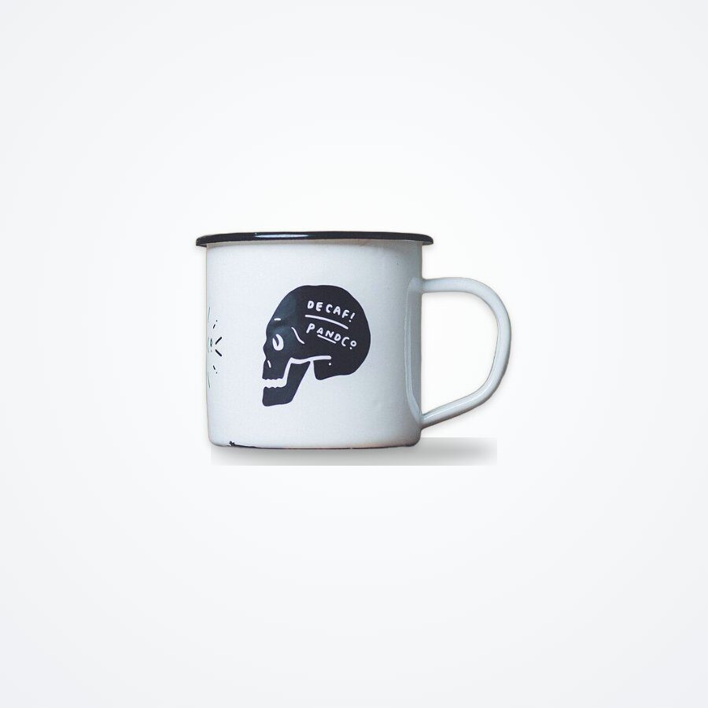 | **Product on white**<br>`product-white` | 2000×2000 | E-commerce square: product cut out, centred on a soft white backdrop with a contact shadow |

</details>

## How it works

<p align="center">
  <picture>
    <source media="(prefers-color-scheme: dark)" srcset="https://raw.githubusercontent.com/fleox/agentphoto/main/.github/assets/how-it-works-dark.png">
    
  </picture>
</p>

All the rules live in one engine. The Studio, the CLI, the MCP server and the Studio assistant are four front doors to it, so an agent can do exactly what you can do in the editor, with the same validation. The engine works on a plain **project folder** (`photo.json`, `assets/`, `renders/`, `dist/`), which you can keep in git.

A picture is **data**: `photo.json` lists layers bottom to top (image, text, shape, fill, adjustment, group), each with its box, opacity, blend mode, mask, filters and effects. The render is a pure function of (document, files, fonts). That is what makes the loop work: the agent patches the JSON, `render` composites it in your headless Chrome and writes a PNG, the agent **looks** at it, fixes, runs `check` and exports. Nothing is ever baked: every filter, mask and cut-out can be changed or removed later. Details: [architecture](https://github.com/fleox/agentphoto/blob/main/docs/architecture.md) and the [document format](https://github.com/fleox/agentphoto/blob/main/docs/document-format.md).

```json
{ "id": "correct", "type": "adjustment", "filters": [
  { "type": "levels", "black": 20, "white": 235 },
  { "type": "temperature", "temperature": -8 },
  { "type": "look", "look": "film", "amount": 0.6 }
] }
```

## How AgentPhoto compares

| | AgentPhoto | A desktop or web photo editor | An online background remover | A web design tool with templates |
|---|---|---|---|---|
| What it is for | photo retouching, cut-outs and visuals | retouching anything by hand | one cut-out at a time | designs from templates |
| How it is driven | an AI agent (CLI, MCP, skills) or the Studio | by hand | upload, then download | by hand in the browser |
| Account or hosted service | ❌ none | depends on the editor | an account / credits, often | an account |
| Your photo leaves your computer | ❌ no (AgentPhoto uploads nothing) | depends | ✅ uploaded | ✅ uploaded |
| AI agent loop (edit, render, look, check) | ✅ | — | — | — |
| Non-destructive layers, masks, filters | ✅ in a JSON file | ✅ in its own format | ❌ | partial |
| Exports at every social size in one command | ✅ `--variants` | by hand | ❌ | ✅ by hand |

Pick a desktop editor for pixel-level manual work on large files, an online remover for a single quick cut-out, and a web design tool when a team designs together in the browser. AgentPhoto fits when an agent should do and verify the edit, the photos must stay on your computer, and the result must stay editable.

## The `agentphoto` CLI

The same engine the agents use, by hand. Every command accepts `--json` and prints exactly one `{ ok, data }` or `{ ok: false, error }` object with an actionable hint; commands that remove or overwrite something print a plan until you add `--yes`.

<p align="center">
  
  <br><sub>A project from a photo, <code>analyze</code>, an adjustment layer with its suggestions, a look, <code>check</code>. The published CLI, real output.</sub>
</p>

<table>
<tr>
<td width="50%"><p align="center"><code>render --compare</code>: the before / after the agent looks at</p></td>
<td width="50%">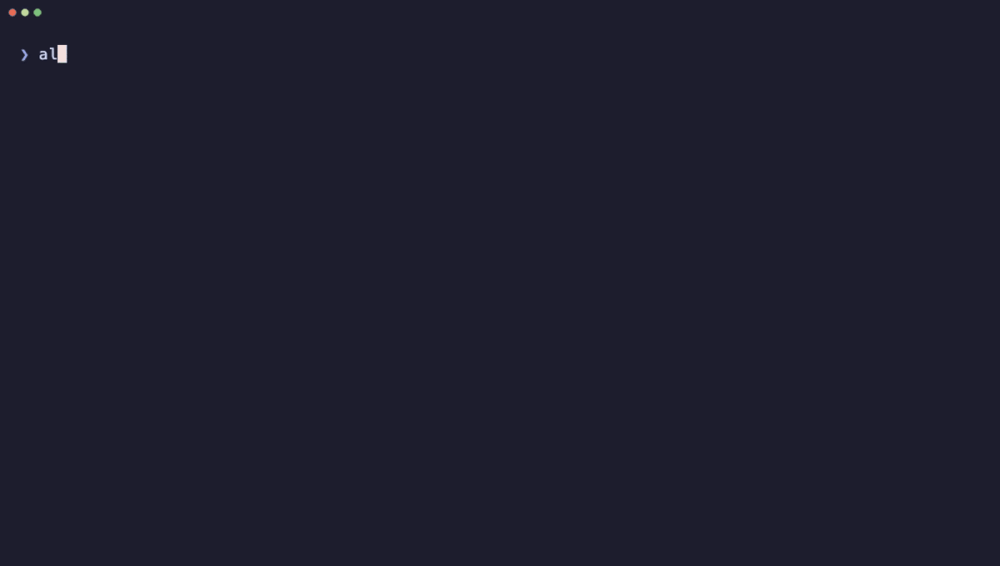<p align="center"><code>export --variants</code>: three sizes, a plan before overwriting</p></td>
</tr>
</table>

<details>
<summary><b>All commands</b></summary>

| Area | Commands |
|---|---|
| Project | `new <dir> [--image] [--template] [--size]`, `info`, `templates list\|show`, `doctor`, `version`, `help` |
| Edit | `doc get\|summary\|apply\|patch\|validate`, `layer list\|get\|add\|update\|remove\|move`, `filter add\|update\|remove`, `mask set\|clear\|generate`, `remove-bg`, `catalog [section] [id]` |
| Look at it | `analyze`, `render [--compare] [--layer] [--zoom]`, `check`, `studio` |
| Ship | `export [--format] [--quality] [--preset] [--width\|--height\|--scale] [--fit] [--variants]` |
| Files and models | `assets list\|add\|remove\|library`, `models list\|pull\|remove` |
| AI | `tools list\|call`, `mcp [--read-only]` |

Full reference: [docs/cli.md](https://github.com/fleox/agentphoto/blob/main/docs/cli.md).

</details>

## MCP server

```bash
claude mcp add agentphoto -- npx -y @fleox/agentphoto@0.1.0 mcp --project ~/Pictures/my-photo
```

<p align="center">
  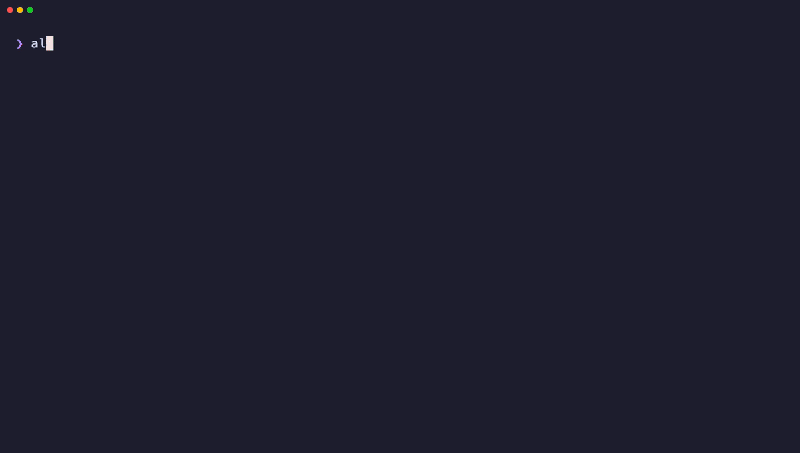
  <br><sub>A raw MCP session: <code>render_preview</code> answers with the picture itself, so multimodal models see their work.</sub>
</p>

**Tools** are the shared AI catalog: project info and creation, document summary / get / patch / apply / validate, layers, filters, masks, `remove_background`, `mask_generate`, `image_analyze`, catalog and templates lookups, assets, `check` and `export`, plus **`render_preview`**, which returns the render as an **image**. **Resources**: `photo://doc`, `photo://summary`, `photo://catalog`. `--read-only` hides every tool that writes. Claude Desktop, Cursor and Hermes configuration: [docs/mcp.md](https://github.com/fleox/agentphoto/blob/main/docs/mcp.md).

## Privacy

- **Local.** Projects are folders on your disk; editing, previews, analysis, AI and exports run on your computer, in Node.js and your own browser engine.
- **AgentPhoto uploads nothing.** The AI models come to the photos: they download **once** from Hugging Face into `~/.cache/agentphoto/models` and then run offline.
- **Nothing else phones home.** No account, no telemetry, no update check, no CDN, no web fonts. The only other network uses are importing an image from a URL you give, and the optional Studio assistant (your own Claude API key, to `api.anthropic.com`; it sends the previews its tools render).
- **Your agent is yours.** An agent you connect (Claude Code, an MCP client) receives the renders it asks for and handles them under its own settings.
- **Non-destructive.** Source files are copied, never modified; AI masks are new files.

Details: [docs/security.md](https://github.com/fleox/agentphoto/blob/main/docs/security.md).

## Documentation

| | |
|---|---|
| [Getting started](https://github.com/fleox/agentphoto/blob/main/docs/getting-started.md) | Install, a first edit in six commands, using it from an agent |
| [Retouching recipes](https://github.com/fleox/agentphoto/blob/main/docs/retouching.md) | Colour correction, portrait retouch, product cut-out on white, social formats |
| [Document format](https://github.com/fleox/agentphoto/blob/main/docs/document-format.md) · [Catalog](https://github.com/fleox/agentphoto/blob/main/docs/catalog.md) | `photo.json` field by field; every filter, look, effect, font and size preset |
| [Studio](https://github.com/fleox/agentphoto/blob/main/docs/studio.md) · [Studio API](https://github.com/fleox/agentphoto/blob/main/docs/studio-api.md) | The visual editor; its local REST API |
| [CLI](https://github.com/fleox/agentphoto/blob/main/docs/cli.md) · [MCP](https://github.com/fleox/agentphoto/blob/main/docs/mcp.md) | Every command; MCP clients |
| [Hermes Agent](https://github.com/fleox/agentphoto/tree/main/hermes) | Skills and Python helpers for Hermes and Python agents |
| [Architecture](https://github.com/fleox/agentphoto/blob/main/docs/architecture.md) · [Security and privacy](https://github.com/fleox/agentphoto/blob/main/docs/security.md) | The engine and the render loop; what touches the network |
| [AGENTS.md](https://github.com/fleox/agentphoto/blob/main/AGENTS.md) · [Releasing](https://github.com/fleox/agentphoto/blob/main/docs/releasing.md) | Instructions for AI agents working on this repository; how versions are published |

## Contributing

Bug reports and ideas are welcome: [open an issue](https://github.com/fleox/agentphoto/issues). See [CONTRIBUTING.md](https://github.com/fleox/agentphoto/blob/main/CONTRIBUTING.md) and, for security reports, [SECURITY.md](https://github.com/fleox/agentphoto/blob/main/SECURITY.md).

```bash
npm install
npm run dev        # the Studio (projects in the browser)
npm test           # Vitest
npm run build      # engine + Studio + CLI
```

## License

Source available under the [PolyForm Noncommercial License 1.0.0](https://github.com/fleox/agentphoto/blob/main/LICENSE). Personal, hobbyist, educational, research and other noncommercial use is free, and you can fork, modify and redistribute under the same terms.

**Commercial use requires written authorization.** This includes selling the software or hosting it as a paid service. For a commercial license, [open an issue](https://github.com/fleox/agentphoto/issues).

**AI models** are downloaded from Hugging Face under their own licences: **RMBG-1.4** (BRIA AI, the default background remover) is **non-commercial only** (`bria-rmbg-1.4` licence; commercial use needs a licence from BRIA); **MODNet**, **SlimSAM** and **SAM** are **Apache-2.0**. `agentphoto models list` shows each one.

**Bundled content**: fonts under the SIL Open Font License 1.1 (Roboto Slab: Apache-2.0) and sample photos under CC0 1.0; see [library/LICENSES.md](https://github.com/fleox/agentphoto/blob/main/library/LICENSES.md). AgentPhoto runs the models with [transformers.js](https://github.com/huggingface/transformers.js) and [ONNX Runtime Web](https://onnxruntime.ai) (Apache-2.0 / MIT).
