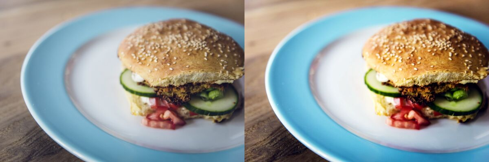
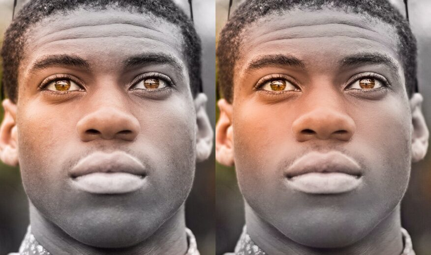
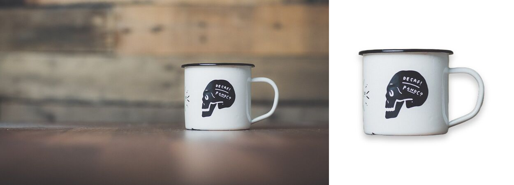
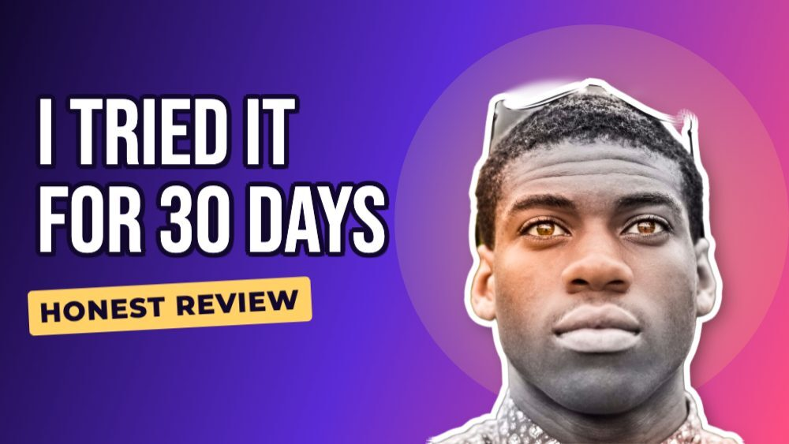

# Retouching recipes

Four everyday jobs, step by step, with the commands an agent runs (you can run them yourself). Every step was run for real on the built-in sample photos; the images below are the actual renders. In a chat with an agent, just describe the result you want: the skills follow these recipes.

Prefix every command with `npx -y @fleox/agentphoto@0.1.2` (or install the package and use `agentphoto`). Add `--json` for machine-readable output.

## Colour correction

<p align="center"></p>

```bash
agentphoto new burger --image ./burger.jpg
agentphoto analyze --project burger          # range 30–225: flat / hazy → levels or autoContrast
agentphoto layer add --project burger --layer '{"id":"correct","type":"adjustment","filters":[{"type":"levels","black":28,"white":235,"gamma":1.05},{"type":"curves","rgb":[[0,0],[64,54],[192,204],[255,255]]},{"type":"temperature","temperature":10},{"type":"vibrance","vibrance":20}]}'
agentphoto filter add photo --type sharpen --set amount=60 --set radius=1 --set threshold=4 --project burger
agentphoto render --project burger --compare  # renders/preview-before.png + preview.png
```

- `analyze` measures brightness, contrast, tonal range, clipping, colour cast and saturation, and suggests filters. A blue lake or an orange sunset is not a cast: trust your eyes.
- Global corrections go into an **adjustment layer** (one place, editable, easy to compare). Order: tone (levels, curves, exposure) → colour (temperature, vibrance) → look.
- Sharpening belongs on the photo layer, last, moderately (`threshold` spares smooth areas such as skin).

## Portrait retouch

<p align="center"></p>

```bash
agentphoto new portrait --image ./portrait.jpg
agentphoto mask generate photo --method points --points '[[768,352,1],[620,640,1],[950,640,1],[784,880,1],[640,496,0],[912,496,0]]' --target copy --copy-id skin --feather 6 --project portrait
agentphoto render --project portrait --layer skin          # only the skin must show
agentphoto filter add skin --type surfaceBlur --set radius=10 --set threshold=20 --set amount=0.7 --project portrait
agentphoto layer add --project portrait --layer '{"id":"grade","type":"adjustment","filters":[{"type":"shadowsHighlights","shadows":30,"highlights":25},{"type":"temperature","temperature":6},{"type":"clarity","amount":12},{"type":"vibrance","vibrance":18}]}'
agentphoto render --project portrait --zoom 560,300,480,480  # judge the skin at 1:1
```

- Segment Anything selects the skin from a few points (`1` include, `0` exclude: eyes, lips) on a **copy** of the photo; the original stays whole underneath.
- `surfaceBlur` is edge-preserving; at `amount` 0.6..0.8 pores stay visible. Plastic skin = lower amount or radius.
- `shadowsHighlights` opens eye sockets and recovers bright foreheads; `clarity` and `vibrance` stay low on faces.

## Product cut-out on white

<p align="center"></p>

```bash
agentphoto new mug --image ./mug.jpg
agentphoto remove-bg photo --background "#ffffff" --shadow --project mug    # → data.subject = { x: 881, y: 306, width: 475, height: 329 }
agentphoto doc patch --project mug '[{"op":"crop","x":769,"y":121,"width":700,"height":700}]'
agentphoto layer update photo --set effects.dropShadow.opacity=0.28 --set effects.dropShadow.distance=14 --set effects.dropShadow.blur=22 --project mug
agentphoto render --project mug --zoom 420,220,200,200     # check the handle and the rim
agentphoto export --project mug --format jpeg --quality 85 --width 1200
```

- Background removal runs locally (RMBG-1.4 by default, MODNet for portraits). It writes a mask, so `mask clear photo` restores the original at any time.
- `subject` (the kept area in canvas px) gives the crop: a square of side ≈ max(width, height) / 0.7 centred on it leaves a 15 % margin.
- `--threshold 128` gives a crisp edge for hard products; the default soft alpha suits hair and fur.
- The `product-white` template has a ready backdrop and floor shadow: `agentphoto new shop --template product-white --image ./mug.jpg`, then `remove-bg photo`.

## Social formats

<p align="center"></p>

```bash
agentphoto templates list
agentphoto new thumb --template youtube-thumbnail --image ./me.jpg
agentphoto remove-bg photo --project thumb
agentphoto layer update title --set 'text="I tried it\nfor 30 days"' --project thumb
agentphoto render --project thumb --max-width 320                  # does it read at small size?
agentphoto export --project thumb --format jpeg --quality 90
```

One design in several sizes:

```bash
agentphoto export --project post --variants '[{"preset":"og","format":"jpeg","quality":85},{"preset":"square","format":"webp","fit":"contain","background":"#0f172a"},{"preset":"story","format":"webp"}]'
```

- Templates (`youtube-thumbnail`, `og-article`, `social-quote`, `story-promo`, `sale-banner`, `polaroid`, `avatar-pro`, `product-white`) put your photo into their `slot` layer with its framing, filters and effects (the sample photo's pre-computed cut-out is not copied: run `remove-bg photo` on yours; on `product-white` that first cut-out also scales the product onto the floor shadow).
- Size presets: `og` 1200×630, `square` 1080×1080, `portrait` 1080×1350, `story` 1080×1920, `landscape` 1920×1080, `youtube` 1280×720, `twitter` 1600×900, `pinterest` 1000×1500, `banner` 1920×600, `linkedin-banner` 1584×396, `avatar` 800×800, `product` 2000×2000, `a4` 1240×1754.
- `--fit cover` crops to the new aspect; `contain` pads. If a crop cuts text or a face, design that format separately.

## More

- Complete, validated documents for these jobs and more (B&W with grain, background blur, a square post with a caption): [`plugin/skills/agentphoto-retouch/references/recipes.md`](../plugin/skills/agentphoto-retouch/references/recipes.md).
- Every filter with its parameters: [catalog.md](catalog.md); patch operations: [`patch-ops.md`](../plugin/skills/agentphoto-retouch/references/patch-ops.md).
