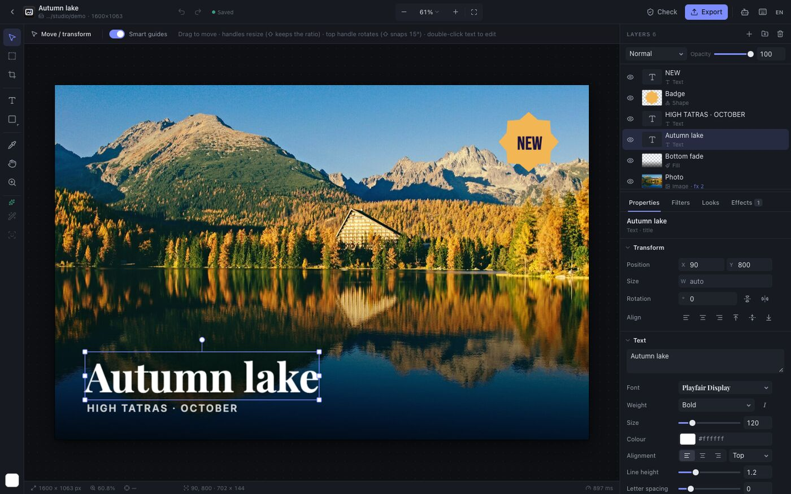

# The Studio

The Studio is AgentPhoto's visual editor: a React app (`src/studio/`, built to `dist/studio/`) with a canvas viewport, a tool rail (move / transform, marquee, lasso and polygonal lasso, magic wand, quick AI select, crop, brush, eraser, clone stamp, text, shapes, hand, zoom, eyedropper), a layers panel, an inspector (properties, filters with live parameters and a curve editor, looks, layer effects, masks, canvas settings), AI dialogs (background removal, masks), an export dialog, the templates gallery on the start screen and an optional AI assistant. It previews with the same engine that renders headless for the agent, so what you see is what exports.

```bash
npx -y @fleox/agentphoto@0.1.0 studio --project my-photo
```

`agentphoto studio` serves the Studio on `http://127.0.0.1:4330/` (next free port; `--port`, `--no-open`) with a local REST API over the project folder (contract: [studio-api.md](studio-api.md)). Edits go through the same AI tool catalog as the CLI and the MCP server, so validation is identical. Changes made by another program (an agent in a terminal, a text editor) are pushed to the open Studio and appear live: you can watch your agent work, then take over by hand.

Without the CLI (`npm run dev` in a clone) the Studio keeps projects in the browser (IndexedDB) and runs the engine in the page. The interface is available in English and French.



## Painting and selections

- **Brush (B), Eraser (E), Clone stamp (S, Alt-click sets the source)** — size (`[` `]`), hardness, opacity, flow. On an image layer each stroke saves a new file in `assets/edits/` (filters and mask stay live); on text, shape or fill layers a new "Paint" layer is created. Click a layer's mask chip to paint the **mask** instead (hide / reveal).
- **Selections** — marquee (M), lasso and polygonal lasso (L), magic wand (W: tolerance, contiguous or whole image), quick AI select (Q: click to include, Alt-click to exclude, Segment Anything runs on this computer). Shift adds, Alt subtracts, Shift+Alt intersects.
- **Selection actions** — mask the layer, delete (hides pixels through the mask), copy to a new layer, fill, masked adjustment layer, invert, feather, crop to the selection.
- **Rasterize layer** (context menu) turns text, shapes and fills into pixels.


## Working with an agent

- Ask the agent to open the Studio on the project when you want to finish by hand (skill `agentphoto-publish`), or run the command yourself in another terminal.
- Everything you do is saved to `photo.json`; AI and painted masks are written as new files in `assets/masks/`, brush / eraser / clone strokes as new files in `assets/edits/` (each stroke is one undo step). Your source photos are never modified.
- The agent reads the document again (`doc summary`) before its next change, so it sees your layers.

## The assistant

The assistant panel runs a tool-use loop with Claude over the same tools (including `render_preview`, whose images it looks at). It calls the Claude Messages API directly from the browser with **your own API key**, stored in the browser's `localStorage` and sent only to `api.anthropic.com`. It is optional; everything else in the Studio works without it, offline.

## AI in the browser

Background removal and Segment Anything masks run in the page (ONNX models through transformers.js, WebAssembly). With `agentphoto studio`, models come from the local cache (`~/.cache/agentphoto/models`) through the server's `/__models/` proxy and are downloaded from Hugging Face only the first time.

## Shortcuts

Tool keys are shown in the tool rail (move `V`, marquee `M`, lasso `L`, magic wand `W`, quick AI select `Q`, crop `C`, brush `B`, eraser `E`, clone `S`, text `T`, shapes `U`, hand `H`, zoom `Z`, eyedropper `I`); the shortcuts dialog in the Studio lists them all and is the reference.

## Security

The Studio server binds 127.0.0.1 only and rejects requests whose `Host` or `Origin` is not local (DNS rebinding / cross-site protection); project paths cannot leave the folder. See [security.md](security.md).
